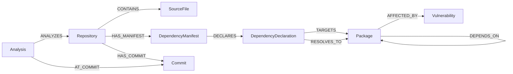

# BlastRadius

**Graph-powered software-supply-chain analysis.** Point BlastRadius at a public
GitHub repository and it resolves an exact commit, builds a provenance-aware
dependency graph in FalkorDB, matches [OSV.dev](https://osv.dev) advisories
against the *resolved* versions, ranks findings with explainable factors, groups
the fixes, answers security questions with an evidence-grounded AI agent over
read-only MCP tools, and can open one human-approved GitHub issue per
remediation plan.

Built and verified in eight phases — **928 offline Python tests** plus live
end-to-end verification on the real stack (FalkorDB, OSV.dev, MCP transport and a
real LLM round-trip) — with a React security-operations UI.

## Quick start

**Prerequisites**

| Requirement | Notes |
|-------------|-------|
| Python 3.11+ | API, graph, OSV, MCP, agent, CLI |
| Node.js 20.19+ (or 22+) | Frontend (Vite 7; verified here on Node 26) |
| FalkorDB | `docker run --name falkordb -p 6379:6379 falkordb/falkordb:2.2.0`, or any reachable instance |
| Git ≥ 2.20 *(optional)* | Enables the faster `git` retrieval strategy; without it an archive download is used |

**1 · Install the backend**

```bash
python -m pip install -r requirements.txt   # or: pip install -e .
```

**2 · Configure — every setting is optional**

```bash
copy .env.example .env      # Windows · cp .env.example .env elsewhere
```

`.env.example` documents every variable with its default. The backend reads
**process environment only and does not auto-load `.env`**, so load it in the
shell that starts the API:

```powershell
# PowerShell
Get-Content .env | ForEach-Object { if ($_ -match '^\s*([A-Za-z_][A-Za-z0-9_]*)\s*=\s*(.+)$') { Set-Item "env:$($Matches[1])" $Matches[2].Trim() } }
```

```bash
# bash
set -a; . ./.env; set +a
```

Ingestion, the graph, OSV findings, prioritization, remediation and the UI need
no configuration. The AI analyst activates when a provider is configured
(`BLASTRADIUS_AGENT_MODEL` + a key — any OpenAI-compatible endpoint works).
GitHub writes activate only when an operator enables them
(`BLASTRADIUS_ACTIONS_ENABLED=true` + a dedicated token + approval secret +
optional repo allowlist).

**3 · Start the stack**

```bash
# FalkorDB — skip if one is already running on localhost:6379
docker run --name falkordb -p 6379:6379 -v falkordb-data:/data falkordb/falkordb:2.2.0

# API — http://127.0.0.1:8000  ·  GET /health reports "graph": true
python -m uvicorn app.main:app --host 127.0.0.1 --port 8000

# UI — build once, then serve (proxies /api + /health to the API)
cd frontend
npm install
npm run build
npm run preview          # http://localhost:4173
# while developing: npm run dev  → http://localhost:5173
```

**4 · First run in the UI (5 minutes)**

1. **Repository** — paste a public GitHub URL (e.g.
   `https://github.com/pypa/sampleproject`) and click **Run ingestion**.
2. **Persist analysis to graph** — the dependency graph lands in FalkorDB.
3. **Sync OSV advisories** — version-confirmed advisories are matched onto the
   graph (exact resolved version only; name-only hits are reported, never stored).
4. **Open analysis** — then walk **Findings** (ranked, per-factor explanations) →
   **Graph explorer** (the blast radius: who reaches what, along which paths) →
   **AI analyst** (evidence-grounded Q&A; needs a provider key) →
   **Remediation** (fix groups ranked by advisory-verified coverage) →
   **GitHub issue** (digest-bound preview; writes disabled by default).

CLI alternative:

```bash
python -m app.cli ingest https://github.com/psf/requests --json
```

**5 · Tests**

```bash
python -m pytest            # 928 passed, 15 skipped — offline, no network needed
cd frontend; npm test       # 53 component/unit tests
```

Opt-in live suites (real network / database / LLM) are listed in the phase
sections below; their toggles live in `.env.example`.

**Docker Compose alternative:** `docker compose up --build` (UI `:8080`,
API `:8000`, FalkorDB internal-only). The artifacts are provided and
self-consistent but **were never executed in this environment** (no Docker CLI
here) — validate them before relying on them; the commands above are the
verified path.

## Graph data model

Everything BlastRadius knows about an analysis lives in **FalkorDB** as a
provenance-aware property graph. Full property-level tables, identifier rules
and query examples: [`docs/GRAPH_SCHEMA.md`](docs/GRAPH_SCHEMA.md).

**Design rules**

- **No fabricated data** — a resolved version exists only when a lockfile states
  it; an `==` pin stays a constraint; `DEPENDS_ON` edges come only from
  lockfiles; vulnerability records are stored exactly as OSV returns them.
- **Provenance everywhere** — repository identity, commit SHA, manifest path,
  line number and evidence are attached, so every finding traces back to source.
- **Repository isolation** — every node carries `repository_id`/`commit_sha`;
  graphs of different repositories (or commits) never merge, even when package
  names collide.
- **Idempotent** — re-persisting the same analysis upserts; it never duplicates.

**Nodes (8)**

| Node | Represents | Key properties |
|------|------------|----------------|
| `Repository` | the analysed repository | `id`, `canonical_id`, `owner`, `name`, `default_branch`, metadata… |
| `Commit` | the exact resolved commit | `sha`, `short_sha`, `message`, `author_name`, `committed_at` |
| `Analysis` | one ingestion run at one commit | `id`, `repository_id`, `commit_sha`, `status`, `files_examined`, `manifests_detected`, `declarations`, `resolved_packages`, `dependency_edges`, … |
| `SourceFile` | a file seen during ingestion | `id`, `path`, `size_bytes`, `sha256`, `manifest_format` |
| `DependencyManifest` | a parsed manifest or lockfile | `id`, `path`, `format`, `is_lockfile`, `status`, `declaration_count`, … |
| `DependencyDeclaration` | one declared dependency | `id`, `original_name`, `normalized_name`, `version_constraint`, `is_exact_pin`, `resolved_version`, `scope`, `relation`, `line_number`, `evidence` |
| `Package` | a resolved or unresolved package | `id`, `normalized_name`, `version` (`""` = unresolved), `is_root_project`, `dependency_count`, … |
| `Vulnerability` | one OSV record (global, shared across analyses) | `id` (OSV id), `aliases`, `severities`, `references`, `affected_packages`, timestamps |

**Relationships (10)**

| Relationship | Meaning |
|--------------|---------|
| `(:Repository)-[:CONTAINS]->(:SourceFile)` | file belongs to the repository |
| `(:Repository)-[:HAS_MANIFEST]->(:DependencyManifest)` | manifest detected in the repository |
| `(:Repository)-[:HAS_COMMIT]->(:Commit)` | commit belongs to the repository |
| `(:Analysis)-[:ANALYZES]->(:Repository)` | analysis covers the repository |
| `(:Analysis)-[:AT_COMMIT]->(:Commit)` | analysis is pinned to the exact commit |
| `(:DependencyManifest)-[:DECLARES]->(:DependencyDeclaration)` | manifest declares a dependency |
| `(:DependencyDeclaration)-[:TARGETS]->(:Package)` | declaration names a package (version may be unresolved) |
| `(:DependencyDeclaration)-[:RESOLVES_TO]->(:Package)` | lockfile-backed resolution to a concrete version |
| `(:Package)-[:DEPENDS_ON { constraint, to_resolved_version, marker, extras, optional, dev, source_manifest, variant_key }]->(:Package)` | a real lockfile dependency edge (conditional variants are `variant_key`-discriminated) |
| `(:Package)-[:AFFECTED_BY { match_type: "version", fixed_versions, ranges_json, … }]->(:Vulnerability)` | OSV-confirmed advisory for the exact resolved version |



**Identifiers** — every node id is `stable_id(prefix, …)`: a SHA-256 digest
truncated to 16 hex chars, deterministic per repository + commit + record key
(for example `Analysis` = `canonical_id | commit_sha`; `Package` =
`canonical_id | commit_sha | normalized_name | version`), so repeated persists
are idempotent and different analyses never share nodes.

**Incomplete data is explicit, never invented**

| Situation | What the graph contains |
|-----------|-------------------------|
| No lockfile | declarations + `TARGETS` links to version-less packages; **no** `RESOLVES_TO`, **no** `DEPENDS_ON` |
| Exact `==` pin without lockfile | constraint kept on the declaration (`is_exact_pin=true`); no resolved package node is created |
| Lockfile present | concrete-version `Package` nodes, `RESOLVES_TO` links, real `DEPENDS_ON` edges |
| Truncated / partial run | `Analysis.status="partial"` with warning/error counts; only actually extracted data is stored |
| Name-only OSV hit | reported as `confirmed=false` / `match_type="name"`; **never written** to the graph |

Reachability is then a plain graph traversal — the query behind the
`analysis.blast_radius` MCP tool:

```cypher
MATCH (src:Package {repository_id: $repository_id, commit_sha: $commit_sha})
      -[:AFFECTED_BY]->(v:Vulnerability)
MATCH (down:Package {repository_id: $repository_id, commit_sha: $commit_sha})
      -[deps:DEPENDS_ON*1..3]->(src)
RETURN down.normalized_name AS dependent,
       src.normalized_name  AS affected_package,
       v.id                 AS vulnerability_id,
       length(deps)         AS hop_count
```

## Where to look next

| Resource | Contents |
|----------|----------|
| [`docs/GRAPH_SCHEMA.md`](docs/GRAPH_SCHEMA.md) | complete graph schema: every property, id and semantic rule |
| [`docs/HACKATHON.md`](docs/HACKATHON.md) | pitch, slide outline, demo script, recording plan, Q&A cheat sheet |
| `docs/PHASE4.md` … `docs/PHASE8.md` | per-phase scope, security models, verification logs |
| `frontend/` | React workspace — `npm run dev` / `build` / `preview` / `test` / `typecheck` |
| `.env.example` | every configuration variable with defaults |

---

*Everything below is the per-phase engineering log (Phase 1 → Phase 8) — how each
layer was built, tested and verified at the time. Start with the two sections
above.*

## Phase 1: Repository Ingestion Engine

BlastRadius is a graph-powered software supply-chain analysis agent. **Phase 1 is the
ingestion engine**: it accepts a public GitHub repository, retrieves an exact commit,
finds Python dependency manifests and returns structured, provenance-carrying dependency
data.

Phase 1 deliberately contains **no** graph database, no AI agent, no MCP server, no
vulnerability scanner and no GitHub write actions. It produces the typed dataset that
those later phases will consume.

## What it actually does

```
GitHub URL (+ optional ref)
        │
        ▼
1. Validate & normalise the URL      https only, github.com only, no credentials,
        │                            safe owner/name characters, optional ref
        ▼
2. Resolve the reference             default branch / branch / tag / commit SHA
        │                            recorded via GitHub REST API (falls back to
        ▼                            `git ls-remote` when the API is unavailable)
3. Retrieve the exact resolved SHA   strategy `git` (fetch by SHA, depth 1) or
        │                            `archive` (codeload tarball for that SHA);
        ▼                            branch moved → recorded + warning, never hidden
4. Safe extraction into a temp dir   path-traversal / symlink / hardlink / device
        │                            members are rejected or skipped; byte and member
        ▼                            caps; `.git` is deleted after retrieval
5. Discover dependency files         `.venv`, `.git`, caches, build outputs excluded;
        │                            file-count and size caps
        ▼
6. Parse manifests                    requirements.txt, pyproject.toml, poetry.lock, uv.lock
        │
        ▼
7. Aggregate + validate              direct/transitive classification, conflicts,
        │                            constraints vs lockfile-resolved versions
        ▼
8. Return typed IngestionResult      repository + commit + provenance, manifests,
                                     declarations, resolved packages, edges, warnings,
                                     errors, summary, limits (HTTP or CLI)
```

Guarantees that hold in every path:

- The **exact resolved commit SHA** is recorded on the result and used for retrieval.
  An unknown ref is rejected — the default branch is never silently substituted.
- Repository code is **never executed**: no `setup.py`, no build backends, no installs,
  no imports of target modules. Git runs with an empty global config, no system config,
  no credentials and `GIT_TERMINAL_PROMPT=0`.
- Versions are **never invented**. `resolved_version` is only set when a lockfile states
  it; `==pin` in a manifest stays a constraint flag.
- Temporary directories are cleaned up on success **and** on every failure path.

## Supported formats (exactly four)

| Format            | Kind        | Extracted                                                                  |
| ----------------- | ----------- | -------------------------------------------------------------------------- |
| `requirements.txt`| manifest    | pins/constraints, extras, markers, editable refs, `-r` includes            |
| `pyproject.toml`  | manifest    | PEP 621 `[project]` + `dependencies`/`optional-dependencies`, Poetry deps, PEP 735 `[dependency-groups]`, `requires-python` |
| `poetry.lock`     | lockfile    | resolved versions + dependency edges (group-aware)                         |
| `uv.lock`         | lockfile    | resolved versions + edges, workspace root dependency names                 |

Detected but **not parsed** (reported as `unsupported_format` warnings): `Pipfile`,
`Pipfile.lock`, `setup.py`, `setup.cfg`, `environment.yml`/`environment.yaml`,
`conda.yml`/`conda.yaml`, `requirements.in`.

Name handling: package names are PyPI-normalised (`charset_normalizer` →
`charset-normalizer`) while the original spelling is preserved on every declaration.
Markers, extras and the declaring manifest/group are kept. A declaration is
`runtime` / `dev` / `optional`; directness is `direct` when a companion manifest lists
it, otherwise `unknown` with a warning — some formats cannot prove transitivity, and
this engine does not guess.

## Run it

Requires **Python 3.11+** and, for the `git` strategy, a `git` binary on `PATH`
(the `archive` strategy needs no Git at all).

```bash
python -m pip install -r requirements.txt          # or: pip install -e .

# HTTP API
python -m uvicorn app.main:app --reload
# POST http://127.0.0.1:8000/api/v1/repositories/ingest
# {"repository_url": "https://github.com/psf/requests", "ref": "v2.32.3"}

# CLI
python -m app.cli ingest https://github.com/psf/requests
python -m app.cli ingest https://github.com/psf/requests --json
python -m app.cli ingest https://github.com/psf/requests --ref v2.32.3
```

Other endpoints: `GET /health`, `GET /api/v1/repositories/formats` (the list of
formats above with per-format capabilities).

The API returns one error envelope for every failure:
`{"error": {"code", "message", "stage", "retryable", "details"}}` with stable codes
(`repository_not_found` → 404, `rate_limit_exceeded` → 429, `repository_too_large` →
413, `unsafe_archive_content` → 422, `download_timeout` → 504, …). Large results are
truncated to `BLASTRADIUS_MAX_API_RECORDS` per collection and flagged in `truncated`.

Configuration lives in environment variables (see `.env.example`): timeouts, download
and extraction byte caps, file/manifest/dependency caps and the optional
`BLASTRADIUS_GITHUB_TOKEN` (raises the anonymous GitHub API limit of 60 requests/hour;
the token is only sent to `api.github.com` and is never passed to Git).

## Tests

```bash
python -m pytest            # 928 passed, 15 skipped (offline; no network required)
```

The offline suite uses mocked HTTP (`httpx.MockTransport`), fake retrievers injected
through production seams and captured `subprocess` calls, and covers URL validation,
retrieval failure modes, all four parsers, aggregation/conflicts, safety helpers,
API validation and the error envelope.

Beyond the Phase 1 skips listed below, the opt-in graph, OSV, MCP and agent
live tests skip until their environment variables are set (see the phase
sections).

Two tests skip by design on this machine:

- the discovery symlink test (creating symlinks requires elevated rights on Windows);
- `tests/test_live_github.py` unless explicitly enabled.

One real, read-only live test can be opted into (anonymous GitHub API rate limits
apply):

```powershell
$env:BLASTRADIUS_RUN_LIVE_TESTS = "1"     # bash: export BLASTRADIUS_RUN_LIVE_TESTS=1
python -m pytest tests/test_live_github.py -m live -s
```

**Live verification performed for this phase** (result of exactly that command):
`github.com/psf/requests`, commit `611c6162cbc4ac2020a2f91c7cfa4f3abf9bbb60`
(branch `main`, resolved via the GitHub API, SHA verified) — strategy `git`,
130 files examined, 4 manifests detected (3 parsed: `docs/requirements.txt`,
`pyproject.toml`, `requirements-dev.txt`; 1 skipped: `setup.py`, unsupported),
27 declarations (all direct; 14 dev, 7 optional), 0 resolved packages (the repository
ships no lockfile — nothing is invented), 9 warnings
(`unsupported_format`, `relation_inferred` ×6, `editable_reference`,
`multiple_constraints_for_package`), status `partial`.

## Limitations

- Public repositories only; no authentication for private repositories is implemented
  (`BLASTRADIUS_GITHUB_TOKEN` only raises the API rate limit).
- Exactly the four formats above; everything else is a warning, not an error.
- Transitive dependencies are only reported from lockfiles; unknown directness stays
  unknown.
- `poetry.lock` format versions are supported up to the tested range (`lock-version`
  1.x); `uv.lock` at `version = 1` (other versions produce a clear warning).
- The `git` strategy requires Git ≥ 2.20; without it the `archive` strategy is used.
- Timeouts are per phase and bounded by `BLASTRADIUS_MAX_INGESTION_SECONDS`; very large
  repositories can therefore end `partial` with a truncation warning.

## Project layout

```
app/
  api/            FastAPI deps + v1 router (request/response schemas, error envelope)
  core/           settings, structured logging, error taxonomy
  ingestion/      urls, github_api, retrieval (git/archive), safety, discovery,
                  parsers/ (requirements, pyproject, poetry.lock, uv.lock),
                  aggregation, service (orchestration)
  models/         typed Pydantic domain models (repository, source, dependencies, ingestion)
  graph/          FalkorDB client, queries, services (Phase 2)
  osv/            OSV.dev client, models, services (Phase 3)
  mcp/            read-only MCP server + tools (Phase 4A)
  agent/          evidence-grounded AI agent: provider adapter, MCP client,
                  bounded loop, grounding checks (Phase 4B)
  remediation/    deterministic prioritization + evidence-backed remediation (Phase 5)
  actions/        user-approved action workflow: config, digest, issue template,
                  SQLite action store, preview/confirm service (Phase 6)
  github/         dedicated write-capable GitHub issue client (Phase 6; the only
                  write path; the Phase 1 ingestion client stays read-only)
  cli.py          `blastradius-ingest` / `python -m app.cli`
frontend/         Phase 7 React + Vite + TypeScript security-ops workspace
                  (dark theme, six screens, Cytoscape graph explorer)
tests/            offline suites + opt-in live tests
```

## Phase 2: FalkorDB Knowledge Graph Engine

Phase 2 persists Phase 1's `IngestionResult` into a real, persistent FalkorDB
knowledge graph.  Ingestion remains fully independent of FalkorDB: the existing
`POST /api/v1/repositories/ingest` endpoint works unchanged whether or not the
graph is configured.

### New graph API endpoints (under `/api/v1`)

| Endpoint | Purpose |
|----------|---------|
| `GET /api/v1/graph/health` | FalkorDB connectivity probe (`connected: true/false`) |
| `POST /api/v1/analyses/{analysis_id}/graph` | Persist a Phase 1 ingestion result (idempotent upsert) |
| `GET /api/v1/analyses/{analysis_id}/graph` | Bounded graph representation of one analysis |
| `GET /api/v1/analyses/{analysis_id}/graph/statistics` | Actual node/relationship counts |
| `GET /api/v1/analyses/{analysis_id}/packages` | Package declarations + resolved versions |
| `GET /api/v1/analyses/{analysis_id}/dependency-edges` | Lockfile-derived dependency edges |
| `GET /api/v1/analyses/{analysis_id}/graph/status` | Graph ingestion status / incomplete-data indicators |
| `GET /api/v1/packages/{package_id}/neighborhood` | Bounded `DEPENDS_ON` neighbourhood |

### Configuration (`BLASTRADIUS_GRAPH_*` environment variables)

See `.env.example` for the full list.  Defaults connect to `localhost:6379`
(graph `blastradius`, database `0`), with optional password/username, TLS, and
timeouts.  The graph is **optional**: when FalkorDB is unavailable, `/health`
reports `connected: false` and graph endpoints return explicit errors — never
fake data.

### Running FalkorDB locally

```bash
docker run --name falkordb -p 6379:6379 falkordb/falkordb:2.2.0
```

Persist data with a volume (`-v falkordb-data:/data`).  Do not expose port 6379
publicly without authentication/network restrictions.

```bash
# configure the app to use it
export BLASTRADIUS_GRAPH_HOST=localhost
export BLASTRADIUS_GRAPH_PORT=6379
export BLASTRADIUS_GRAPH_NAME=blastradius
```

### Running the graph tests

```bash
python -m pytest            # 928 passed offline (no FalkorDB needed)
# opt-in integration tests against a real FalkorDB:
$env:BLASTRADIUS_GRAPH_LIVE_TESTS = "1"   # bash: export BLASTRADIUS_GRAPH_LIVE_TESTS=1
python -m pytest tests/test_graph_integration.py -s
```

## Graph schema

See `docs/GRAPH_SCHEMA.md` for the complete node/relationship schema, identifier
conventions, Cypher query examples, and incomplete-data semantics.

## Phase 2 interface

Phase 2 consumes `IngestionResult` (`app/models/ingestion.py`) — the same
structure returned by `POST /api/v1/repositories/ingest`:

- `repository` → identity, commit (SHA/message/author/source), stats, metadata source;
- `reference` → what was requested, how it resolved, whether the SHA was verified;
- `source_files` → path, size, sha256, manifest classification, provenance;
- `manifests` → format, parse status, capabilities, warnings/errors;
- `declarations` → package (original + normalised), constraint, scope, group, marker,
  extras, relation, `resolved_version`/`resolved_from` when a lockfile states one;
- `resolved_packages` + `dependency_edges` → lockfile graph, keyed by
  `(ecosystem, normalised name)`;
- `warnings`, `errors`, `summary`, `limits` → completeness and fidelity signals.

Ingestion is fully independent of FalkorDB: any storage layer can be fed from these
models without touching the retrieval or parsing code.

## Phase 3: OSV.dev Vulnerability Intelligence

Phase 3 queries the official [OSV.dev database](https://google.github.io/osv.dev/api/)
for the analysis's resolved packages and mirrors confirmed vulnerabilities into
the FalkorDB graph.  It is read-only (no OSV credentials), targeted (no
full-database ingestion), and strictly version-backed.

### New API endpoints (under `/api/v1`)

```bash
# live OSV lookup for one package (no graph writes; unconfirmed without version)
# GET /api/v1/osv/vulnerabilities?name=requests&ecosystem=pypi&version=2.3.0

# targeted ingestion of OSV data for a persisted analysis (idempotent)
# POST /api/v1/analyses/{analysis_id}/vulnerabilities

# graph-backed vulnerability listing for an analysis
# GET /api/v1/analyses/{analysis_id}/vulnerabilities

# explainable impact paths (hop_count 0 = affected package, 1+ = downstream)
# GET /api/v1/analyses/{analysis_id}/vulnerabilities/blast-radius?depth=3

# one stored OSV record + every graph component linked to it
# GET /api/v1/vulnerabilities/{vulnerability_id}
```

### Semantics worth knowing

- Only packages **with a resolved version** produce
  `(:Package)-[:AFFECTED_BY]->(:Vulnerability)` edges, and only when OSV
  confirmed that exact version (`match_type="version"`).  Name-only lookups
  return `confirmed: false` and are never written.
- Stored severities/references/ranges are exactly what OSV returned — BlastRadius
  never computes a severity or score, and missing metadata is never overwritten
  by a later sync.
- Ingestion reports per-item errors (`discovery`/`hydrate`/`decode`/
  `package_mismatch`/`name_only`) instead of failing silently; a run whose OSV
  connection utterly fails surfaces the 502/429/504 envelope.

### Configuration (`BLASTRADIUS_OSV_*` environment variables)

| Variable | Default |
|----------|---------|
| `BLASTRADIUS_OSV_BASE_URL` | `https://api.osv.dev` |
| `BLASTRADIUS_OSV_TIMEOUT_SECONDS` / `BLASTRADIUS_OSV_CONNECT_TIMEOUT_SECONDS` | `20` / `5` |
| `BLASTRADIUS_OSV_MAX_RETRIES` / `BLASTRADIUS_OSV_RETRY_BACKOFF_SECONDS` | `3` / `0.5` |
| `BLASTRADIUS_OSV_BATCH_SIZE` | `50` |
| `BLASTRADIUS_OSV_MAX_PAGES_PER_QUERY` | `5` |
| `BLASTRADIUS_OSV_MAX_VULNERABILITIES_PER_INGEST` | `200` |
| `BLASTRADIUS_OSV_MAX_PACKAGES_PER_INGEST` | `200` |
| `BLASTRADIUS_OSV_MAX_DETAILS_LENGTH` | `4000` |
| `BLASTRADIUS_OSV_MAX_REFERENCES_PER_VULNERABILITY` | `50` |

### Running the vulnerability tests

```bash
# offline: mocked OSV HTTP, no network, no FalkorDB (part of the default suite)
python -m pytest tests/test_osv_models.py tests/test_osv_client.py tests/test_osv_service.py -q

# opt-in live tests against real OSV.dev (and FalkorDB for the end-to-end test):
$env:BLASTRADIUS_OSV_LIVE_TESTS = "1"
$env:BLASTRADIUS_GRAPH_LIVE_TESTS = "1"    # only needed for the full e2e test
python -m pytest tests/test_osv_live.py -s
```

## Phase 4: MCP Server (AI client interface)

Phase 4 exposes BlastRadius's dependency graph and OSV vulnerability intelligence
to AI clients through a **Model Context Protocol (MCP) server** using Streamable
HTTP transport.  The server is read-only: it surfaces existing graph reads and
OSV lookups, never writes to FalkorDB or OSV.

See `docs/PHASE4.md` for the complete scope, tool contracts, security model, and
testing strategy.

### New MCP endpoint

```
# MCP Streamable HTTP endpoint (mounted on the FastAPI app)
# POST http://127.0.0.1:8000/mcp/   (MCP JSON-RPC)
#
# The MCP session manager is run inside the FastAPI lifespan: Starlette never
# dispatches ASGI lifespan events to a mounted sub-app, so running it from the
# parent app startup is required for the transport to work.
# The full client-to-server protocol lifecycle (initialize -> tools/list ->
# tools/call -> session termination) is verified by tests/test_mcp_http.py,
# which drives the real FastAPI app over HTTP with the official MCP Python SDK
# client (offline: loopback HTTP, fake graph/OSV services, no FalkorDB).
```

### Implemented tools (Phase 4A, all read-only)

| Tool | Purpose |
|------|---------|
| `graph.health` | FalkorDB connectivity probe |
| `analysis.status` | Graph ingestion status for one analysis |
| `analysis.statistics` | Node/relationship counts for one analysis |
| `analysis.packages` | Package declarations + resolved versions |
| `analysis.dependency_edges` | Lockfile-derived dependency edges |
| `package.neighborhood` | Bounded `DEPENDS_ON` neighbourhood (depth 1-5) |
| `analysis.vulnerabilities` | OSV vulnerabilities for an analysis's packages |
| `analysis.blast_radius` | Explainable impact paths (`hop_count` 0 = affected) |
| `vulnerability.get` | Stored OSV vulnerability record |
| `vulnerability.components` | Graph components affected by a vulnerability |
| `osv.lookup` | Live read-only OSV.dev lookup (no graph writes) |

### Running MCP tests

```bash
# offline: deterministic tests with mocked services (part of the default suite)
python -m pytest tests/test_mcp_server.py tests/test_mcp_http.py -q

# opt-in live tests against real FalkorDB + OSV.dev:
$env:BLASTRADIUS_GRAPH_LIVE_TESTS = "1"
$env:BLASTRADIUS_OSV_LIVE_TESTS = "1"
$env:BLASTRADIUS_GRAPH_NAME = "blastradius_mcp_livetest"
python -m pytest tests/test_mcp_live.py -s
```

## Phase 4B: Evidence-Grounded AI Agent

Phase 4B adds an AI agent that answers security questions about one ingested
analysis.  The agent discovers the Phase 4A tools over MCP `tools/list`,
lets a configurable LLM provider choose tool calls, validates every call
(tool allowlist + analysis scope) before execution, feeds the **actual** MCP
results back to the model, and only returns answers that pass a deterministic
grounding check against the collected evidence.  It is read-only: no
arbitrary Cypher, no shell, no graph writes, no OSV ingestion, no GitHub
writes.

See `docs/PHASE4B.md` for the complete architecture, security model, and test
strategy.

### New API endpoint

```
# Ask one security question about one analysis (evidence-grounded answer)
# POST http://127.0.0.1:8000/api/v1/analyses/{analysis_id}/ask
# {"question": "Which components appear in the reported impact paths?", "max_rounds": 4}

# Example response (abridged):
# {
#   "analysis_id": "...", "answer": "... [analysis.vulnerabilities]",
#   "grounded": true, "incomplete": false, "rounds_used": 2,
#   "tool_calls": [{"round_index": 1, "name": "analysis.vulnerabilities",
#                    "status": "executed", "reason": null, ...}],
#   "evidence": [{"tool": "analysis.vulnerabilities", "excerpt": "...", ...}],
#   "limitations": [], "repository_id": "...", "commit_sha": "...",
#   "advisory_links": ["https://osv.dev/vulnerability/CVE-..."]
# }
```

Error responses use the shared envelope (`agent_not_configured` 503,
`agent_provider_error` / `agent_mcp_unavailable` 502, `agent_timeout` 504,
`repository_not_found` 404, `invalid_input` 422/400).  Credentials never
appear in responses or logs.

### Agent configuration (`BLASTRADIUS_AGENT_*` environment variables)

| Variable | Default | Purpose |
|----------|---------|---------|
| `BLASTRADIUS_AGENT_MODEL` | *(empty — required)* | Model name (e.g. `gpt-4o-mini`) |
| `BLASTRADIUS_AGENT_API_KEY` | *(empty)* | Provider key; falls back to `OPENAI_API_KEY` |
| `BLASTRADIUS_AGENT_BASE_URL` | `https://api.openai.com/v1` | OpenAI-compatible endpoint |
| `BLASTRADIUS_AGENT_MCP_URL` | `http://127.0.0.1:8000/mcp/` | MCP endpoint the agent connects to |
| `BLASTRADIUS_AGENT_TIMEOUT_SECONDS` | `60` | Overall per-question budget |
| `BLASTRADIUS_AGENT_PROVIDER_TIMEOUT_SECONDS` | `30` | Per-LLM-call HTTP timeout |
| `BLASTRADIUS_AGENT_MAX_ROUNDS` | `4` (max 8) | Reasoning rounds per question |
| `BLASTRADIUS_AGENT_MAX_TOOL_CALLS_PER_ROUND` | `4` (max 8) | Tool executions per round |
| `BLASTRADIUS_AGENT_MAX_QUESTION_CHARS` | `1000` | Question length cap |
| `BLASTRADIUS_AGENT_MAX_TOOL_RESULT_CHARS` | `20000` | Per-tool-result cap |
| `BLASTRADIUS_AGENT_MAX_EVIDENCE_CHARS` | `120000` | Total evidence budget |
| `BLASTRADIUS_AGENT_MAX_OUTPUT_CHARS` | `8000` | Final answer cap |
| `BLASTRADIUS_AGENT_STRICT_GROUNDING` | `true` | Withhold answers with ungrounded identifiers |

The provider dialect is configurable via `BLASTRADIUS_AGENT_PROVIDER`
(`openai-compat` — the only dialect implemented in Phase 4B; any
OpenAI-compatible gateway works through `BASE_URL`).  Without credentials the
endpoint returns `503 agent_not_configured` instead of partially executing.

### Example

```powershell
$env:BLASTRADIUS_AGENT_MODEL = "gpt-4o-mini"
$env:BLASTRADIUS_AGENT_API_KEY = "sk-..."
uvicorn app.main:app --port 8000

curl -s -X POST "http://127.0.0.1:8000/api/v1/analyses/$ANALYSIS/ask" `
     -H "Content-Type: application/json" `
     -d '{"question": "What vulnerabilities are associated with this analysis?"}'
```

### Bounded loop guarantees

- Tool names come exclusively from MCP `tools/list` — nothing is hardcoded, and
  prompt-injected tool names (`osv.ingest`, `graph.delete`, ...) cannot execute.
- Analysis-scoped tools must receive exactly the path `analysis_id`; any other
  value is rejected as `cross_analysis_call_rejected`.
- Rounds, per-round calls, total evidence, per-result size, overall latency and
  final answer length are all capped; exhausted budgets produce
  `incomplete=true` with machine-readable limitations, never fabricated facts.
- The grounding scanner withholds answers naming advisory IDs/links/scores that
  do not literally appear in the collected evidence (`strict_grounding`), and a
  non-strict mode flags them instead.
- Advisory/repository text is treated as untrusted data: it arrives only in
  tool-role messages and cannot change tool permissions or scope.

### Running agent tests

```bash
# offline: deterministic doubles + real MCP transport on loopback HTTP
python -m pytest tests/test_agent_config.py tests/test_agent_provider.py \
    tests/test_agent_loop.py tests/test_agent_api.py tests/test_agent_integration.py -q

# opt-in LIVE LLM test (requires real provider credentials; NOT runnable offline):
$env:BLASTRADIUS_AGENT_LIVE_TESTS = "1"
$env:BLASTRADIUS_AGENT_MODEL = "gpt-4o-mini"
$env:BLASTRADIUS_AGENT_API_KEY = "sk-..."
python -m pytest tests/test_agent_live.py -s
```

**Live LLM status:** verified live after Phase 8 with an OpenAI-compatible
provider (Groq, `openai/gpt-oss-120b`): the agent chose and executed a real
MCP tool call (`graph.health`, status `executed`) against the live FalkorDB
graph and returned a grounded answer in ~7.5 s. The adapter remains covered
offline against mocked HTTP, and the orchestration against deterministic
doubles plus the real MCP transport.

## Phase 5: Deterministic Prioritization & Evidence-Backed Remediation

Phase 5 turns the persisted graph/OSV facts into two deterministic, read-only
outputs: **ranked findings with per-factor explanations** and **advisory-backed
fix groups ranked by verified impact**. The engine is LLM-free (it works with no
provider configured) and never writes to the graph, repository or GitHub. It
never installs packages, runs a resolver, invents a fixed version or computes a
CVSS score.

See `docs/PHASE5.md` for the full formula, evidence rules and limitations.

### Priority formula (`blastradius-priority-v1`)

```text
score = 100 * (0.40 * severity + 0.30 * reachability
             + 0.20 * impact   + 0.10 * remediation)
```

- **severity** — advisory numeric score / 10; vector-only or missing severity is
  neutral `0.5` (vectors are never converted). This is advisory data, separate
  from the custom score.
- **reachability** — `direct` 1.0, `reachable_from_entry` 0.75,
  `not_reachable` 0.35, `unavailable` 0.5. "Not reachable" means no modeled path
  was found within 5 hops, never proven unexploitable.
- **impact** — `min(1, log2(1 + dependents) / 3)`.
- **remediation** — `1.0` when the advisory declares a fixed version, `0.25`
  otherwise.

Missing data is neutral, not zero. Ties break on advisory numeric severity,
reachability tier, then `finding_id`. Advisory severity, reachability,
compatibility and remediation availability remain separate fields; the custom
score is never labelled CVSS.

### Remediation rules

Candidates come only from advisory-declared fixed versions. Each is validated
against the stored OSV ranges (`resolves` / `not_resolving` / `unknown`; the
current version must be re-confirmed affected) and the recorded declaration/edge
constraints (`constraints_satisfied` / `constraints_violated` / `unverified`).
No resolver is executed. Fix groups are per affected package; only
range-validated resolutions count toward the ranking, and each finding belongs
to exactly one group. Unresolved findings are reported separately with reasons.

### New API endpoints (all read-only `GET`)

```text
GET /api/v1/analyses/{analysis_id}/findings
GET /api/v1/analyses/{analysis_id}/findings/{finding_id}
GET /api/v1/analyses/{analysis_id}/remediation/candidates
GET /api/v1/analyses/{analysis_id}/remediation/groups
GET /api/v1/analyses/{analysis_id}/remediation/groups/{group_id}
```

Pagination is validated (`skip >= 0`; caps 500/200/200), ids are
analysis-scoped, and unknown analyses/findings/groups return the shared 404
envelope. Caller-supplied CVEs, severities or fixed versions are rejected with
`400 invalid_input` (only `skip`/`limit` are accepted where defined); the
routes accept no advisory data. Mutating methods return `405`.

### New MCP tools (existing 11 unchanged — 15 total)

| Tool | Purpose |
|------|---------|
| `findings.priority` | Ranked findings with factor-level evidence (max 100/page) |
| `findings.detail` | One finding's factors, reachability and package plan |
| `remediation.groups` | Ranked fix groups + unresolved findings with reasons |
| `remediation.group` | One group's advisory evidence, checks and constraints |

The agent may explain these results but is instructed not to compute scores or
invent upgrade versions; it must use the tool-returned priorities, versions and
compatibility statuses.

### Running Phase 5 tests

```bash
python -m pytest tests/test_remediation_ranges.py tests/test_remediation_versions.py \
    tests/test_remediation_priority.py tests/test_remediation_service.py \
    tests/test_remediation_api.py tests/test_remediation_mcp.py -q
# 97 passed (part of the default offline suite)

# real MCP transport, including findings.priority:
python -m pytest tests/test_agent_integration.py -q
```

**Phase 5 status:** implemented and verified offline (canned graph facts, real
MCP transport, no live FalkorDB and no live LLM). The skipped tests are the
opt-in live suites (graph, OSV, ingestion, MCP, LLM, and now Phase 6 issue
creation) plus the Windows symlink test.

## Phase 6: User-Approved GitHub Remediation Issues

Phase 6 can create **one GitHub issue per explicitly approved remediation plan**
from the Phase 5 evidence. It is a write path, so it is deliberately narrow:

- **disabled by default** — both endpoints answer `403 github_write_disabled`
  until `BLASTRADIUS_ACTIONS_ENABLED=true` *and* a dedicated token is configured;
- **preview first** — a deterministic, digest-bound Markdown proposal is
  generated from server-side evidence; producing it never writes to GitHub;
- **explicit authorization** — confirmation requires a dedicated approval
  secret sent in the `X-BlastRadius-Approval` header (constant-time compare).
  An action id alone is never sufficient, and no LLM/tool output or natural
  language can authorize a write;
- **idempotent and auditable** — every action is persisted with an atomic state
  machine (`PREVIEWED → EXECUTING → SUCCEEDED | FAILED`, `PREVIEWED → EXPIRED`),
  an ambiguous outcome is reconciled through a unique marker in the issue body
  (never blindly retried), and completed actions replay their stored result;
- **no PRs, no package upgrades, no repository edits, no arbitrary GitHub API
  access** — the only write is `POST /repos/{owner}/{repo}/issues`.

See `docs/PHASE6.md` for the full approval architecture, permissions, error
taxonomy, idempotency/recovery semantics and limitations.

### New API endpoints (write-gated)

```text
POST /api/v1/analyses/{analysis_id}/remediation/github-issue/preview
     {"group_id": "fixgroup_..."}          # or {"finding_id": "finding_..."}
# -> 201 {action_id, payload_digest, title, body, repository, commit_sha,
#          expires_at, limitations, notes, state:"PREVIEWED"} — no GitHub write

POST /api/v1/actions/github-issue/confirm
     X-BlastRadius-Approval: <BLASTRADIUS_ACTIONS_APPROVAL_SECRET>
     {"action_id": "act_...", "payload_digest": "sha256:..."}
# -> 200 {state:"SUCCEEDED", issue_number, issue_url, created, reconciled, ...}
```

The target repository is derived server-side from the analysis `Repository`
record (canonical owner/name + analysed commit); owner, name, severity, fixed
versions or a custom body cannot be supplied by the caller (`400/422`). The
confirm request is bound to the exact previewed payload digest, expires
(default 900 s) and is rejected after a definitive failure or an ambiguous
outcome (`409`/`502`), so an issue is never silently created twice.

### New MCP tool (existing 15 unchanged — 16 total)

| Tool | Purpose |
|------|---------|
| `remediation.issue_preview` | Prepare (never create) a digest-bound GitHub issue proposal from one fix group or finding |

There is deliberately **no LLM-callable write tool**: the agent can prepare a
proposal and explain it, but only an operator with the approval secret can
confirm the write.

### Configuration (`BLASTRADIUS_ACTIONS_*` environment variables)

```text
BLASTRADIUS_ACTIONS_ENABLED=false                 # safe default: writes disabled
BLASTRADIUS_ACTIONS_GITHUB_TOKEN=                 # fine-grained token, Issues: write
BLASTRADIUS_ACTIONS_APPROVAL_SECRET=              # confirmation secret (required)
BLASTRADIUS_ACTIONS_GITHUB_API_BASE_URL=https://api.github.com   # https only
BLASTRADIUS_ACTIONS_PREVIEW_TTL_SECONDS=900
BLASTRADIUS_ACTIONS_STORE_PATH=                   # SQLite action store (durable path)
BLASTRADIUS_ACTIONS_REPOSITORY_ALLOWLIST=         # optional: owner/repo,...
BLASTRADIUS_ACTIONS_MAX_TITLE_CHARS=256
BLASTRADIUS_ACTIONS_MAX_BODY_CHARS=60000
```

The token and the approval secret are read only from the environment, are never
logged, echoed in an error envelope, persisted in the action store or embedded
in an issue body.

### Running Phase 6 tests

```bash
python -m pytest tests/test_actions_config.py tests/test_actions_issue_content.py \
    tests/test_github_issue_client.py tests/test_actions_store.py \
    tests/test_actions_service.py tests/test_actions_api.py \
    tests/test_actions_mcp.py -q
# 162 passed (part of the 928-passed default suite)

# opt-in LIVE write test — creates a REAL issue; requires an explicitly
# authorized sandbox repository you own (see docs/PHASE6.md, section 13):
python -m pytest tests/test_actions_live.py -m live_write -s
```

**Phase 6 status:** implemented and verified offline (mocked GitHub HTTP, real
service/store/client code). No live issue was created in this environment: no
GitHub credentials and no designated sandbox repository are configured here.
The live creation test is opt-in, requires an exact id-bound authorization, and
never runs as part of the default suite.

## Phase 7: Security Operations Frontend

Phase 7 adds the operator workspace in `frontend/` (React 19 + Vite + TypeScript +
Tailwind CSS + Cytoscape.js + TanStack Query + React Router). It consumes only the
real Phase 1–6 HTTP API through one typed client generated from a committed
`openapi.json` snapshot — **no fabricated data, no client-side scoring, no
reachability computed in the browser, and no backend logic duplicated in
components.** Backend behaviour, formulas, guards and storage are unchanged; the
phase string stays `phase-4b-agent`.

Six screens, one route per context:

| Screen | Route | Consumes |
|--------|-------|----------|
| A — Repository analysis | `/` | `POST /repositories/ingest` → `POST /analyses/{id}/graph` → `POST /analyses/{id}/vulnerabilities` (real sequencing preserved) |
| B — Findings | `/analysis/:id/findings` | `GET /findings`, `GET /findings/{finding_id}` |
| C — Graph explorer | `/analysis/:id/graph` | `GET /graph`, `/graph/statistics`, `/graph/status`, `/packages`, `/dependency-edges`, `/vulnerabilities`, `/vulnerabilities/blast-radius`, `/packages/{id}/neighborhood` |
| D — Analyst | `/analysis/:id/analyst` | `POST /analyses/{id}/ask` (Phase 4B agent) |
| E — Remediation | `/analysis/:id/remediation` | `GET /remediation/groups[/{id}]`, `GET /remediation/candidates` |
| F — Approved issue | `/analysis/:id/issue` | `POST .../remediation/github-issue/preview`, `POST /actions/github-issue/confirm` (Phase 6) |

Honesty rules the UI enforces everywhere: advisory severity and the BlastRadius
priority score are always shown as separate fields; "no modeled path" is never
worded as "safe"; potential remediation candidates are never relabelled as
confirmed fixes; every statistic, coverage count, compatibility status and issue
body comes from a backend response; unavailable services (FalkorDB, OSV, LLM
provider, GitHub writes) produce their real error envelope, not simulated data.

The dev and preview servers proxy `/api` and `/health` to the backend
(`BLASTRADIUS_BACKEND_URL`, default `http://127.0.0.1:8000`), so no backend CORS
change is needed; deployed builds can set `VITE_API_BASE_URL` instead.

```powershell
cd frontend
npm install
npm run dev          # http://localhost:5173 (backend must be running)

npm run typecheck    # tsc -b (strict)
npm run lint         # eslint
npm run format:check # prettier
npm test             # vitest: 53 component/unit tests
npm run build        # tsc -b && vite build -> dist/
npm run preview      # serve dist/ with the same API proxy (port 4173)
```

Screen F approval handling: the approval secret is typed per confirmation, held in
memory, sent once as `X-BlastRadius-Approval`, and cleared on every settle. It is
never placed in frontend code, Vite env vars, the compiled bundle, `localStorage`
or `sessionStorage`, and no digest/expiry/evidence/idempotency guard is bypassed.
That entry flow is documented as **local-development-only**; a production
deployment must authenticate/authorize access to the API. Expired or
evidence-changed previews are discarded and require a new preview; a repeated
confirmation renders the stored result (`created: false`) instead of claiming a
second issue.

Opt-in live-backend smoke test (drives the frontend's own client and graph adapter
against a running API):

```powershell
cd frontend
$env:BLASTRADIUS_FRONTEND_INTEGRATION = "1"
$env:VITE_API_BASE_URL = "http://127.0.0.1:8000"
npx vitest run src/integration/backend.smoke.test.tsx   # 8/8 passed here
```

**Phase 7 status:** verified in this environment — production build and preview
server (real proxied API), a real ingest → persist → OSV-sync run of
`github.com/pypa/sampleproject` through the dev proxy, and real findings, impact
paths and fix groups from the pre-existing `analysis_9ea623c6550a26c0`. Not
verified live: LLM answers (no provider credentials at Phase 7 time → the real
`503 agent_not_configured` path was exercised there; the live LLM round-trip was
verified afterwards — see Phase 4B) and actual GitHub issue creation
(no write token → real `403 github_write_disabled`). See `docs/PHASE7.md` for the
full architecture, security notes, verification log and limitations.

## Phase 8: End-to-End Verification, Deployment Readiness & Submission

Phase 8 adds no product behaviour: it proves Phases 1–7 end to end on the real
stack, fixes the genuine defects verification surfaced, and packages the project
for deployment. Full report, evidence and blockers: `docs/PHASE8.md`.

Verified live (dedicated verification graph): the full workflow on two
repositories — `github.com/pypa/sampleproject` (12 files, 4 declarations,
24 nodes) and `github.com/python-poetry/poetry` (49 manifests, 115 declarations,
83 resolved packages, 121 dependency edges, 500 nodes / 659 relationships) —
then OSV sync (88 advisories, 90 edges), 90 findings with evidence, 50 impact
paths, 14 remediation groups, and exact graph reconciliation including zero
cross-analysis node overlap. The Phase 6 safeguards were exercised with a local
placeholder token: allowlist, approval secret, payload digest, expiry/revalidation
and the kill switch all held; the server log shows exactly two outbound GitHub
requests (both read-only preflights) for nine probe calls. The built frontend was
driven end to end in a real browser (Microsoft Edge): ingest → persist → findings
→ graph explorer → remediation → analyst → issue preview, with only the two
intentional API outcomes in the console (503 agent, 403 writes-disabled).

Defects found by that verification and fixed (each with a regression test where
the fix is backend): statistics/read-query timeouts from a cartesian query plan;
`_detect_conflicts` `None`-sort crash; missing catch-all error envelope; MCP
`graph.health` settings path; read-only retry against a not-yet-created graph;
cross-analysis manifest/declaration id collisions (now analysis-scoped); merged
conditional `DEPENDS_ON` variants (now `variant_key`-discriminated); Repository
nodes missing their identity properties (broke issue preview with
`409 action_repository_invalid`); a `/favicon.ico` 404 in the SPA.

```powershell
# local path (verified in this environment)
python -m uvicorn app.main:app --host 127.0.0.1 --port 8000
cd frontend; npm ci; npm run build
$env:BLASTRADIUS_BACKEND_URL = "http://127.0.0.1:8000"; npm run preview -- --port 4173

# container path (authored; not executed here — no Docker CLI in this environment)
copy .env.example .env; docker compose up --build   # UI :8080, API :8000, MCP /mcp/
```

Test tallies after Phase 8: Python offline **928 passed / 15 skipped**; live
opt-in suites **11 passed**; frontend **53 passed / 8 skipped** (the skipped file
is the opt-in live-backend smoke test). Deployment artifacts: `Dockerfile`,
`.dockerignore`, `frontend/Dockerfile`, `frontend/nginx.conf`,
`docker-compose.yml` (FalkorDB is not published to the host; the action store
lives on a named volume).

**Phase 8 status:** verification complete and truthful about its limits. Not
verified at Phase 8 time: a live LLM answer (no provider credentials then → the
real `503 agent_not_configured` path was exercised; the live LLM round-trip was
verified afterwards with Groq `openai/gpt-oss-120b` — real MCP tool call,
grounded answer), a real GitHub issue write (no write token / authorized sandbox
repository → the safeguards were verified up to the read-only preflight), and
the Docker Compose build itself (no Docker CLI). Exact environment variables and
commands to finish the remaining two are listed in `docs/PHASE8.md` section 7.
